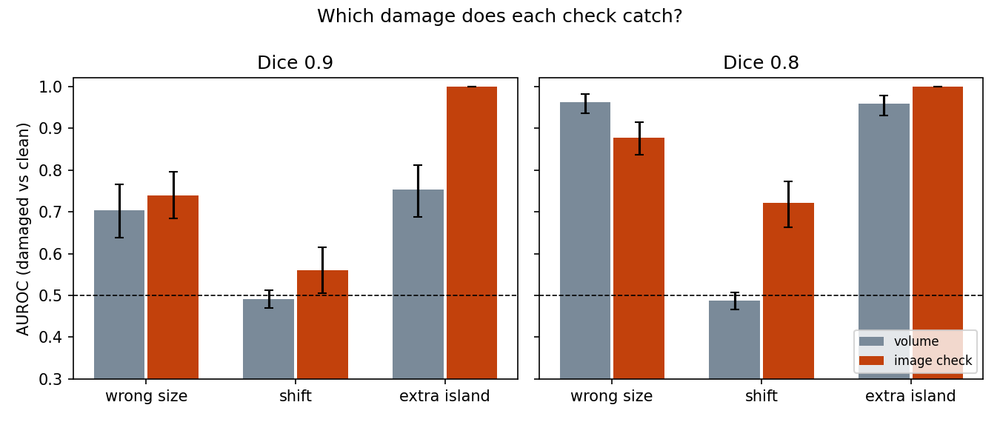

# Which segmentation-mask errors does a simple check catch, and which does it miss?

A small audit loop: take MRI segmentation masks that are assumed correct, damage them in three known ways at two known sizes, run two simple automatic checks, and report how well each separates damaged from undamaged masks. The point is the list of blind spots.
Design, written before the run (including numeric predictions): [DESIGN.md](DESIGN.md).

**Data.** Medical Segmentation Decathlon, Task04 Hippocampus (CC-BY-SA 4.0), 260 cases, anterior + posterior labels merged into one binary mask. Public data; method demo only, no clinical claim.

## What was done
- **Damage, size set by overlap (Dice) with the clean mask, 0.9 and 0.8.** Each case gets its own parameter by bisection; the target was hit within 0.01 for 100% of 60 pilot cases (`pilot_damage.py`).
  - *wrong size*: smoothed mask thresholded up (too small) or down (too big); volume -18% / -33% or +22% / +50% at Dice 0.9 / 0.8
  - *shift*: mask moved in a random direction (volume about -3%)
  - *extra island*: a separate ball away from the structure; volume +22% / +50% (the 0.8 island is half the structure, which is extreme)
- **Two checks**, calibrated on clean masks of cases 0-99 (no labels learned):
  - *volume only* (never sees the image): distance of the mask volume from normal; the population volume spread is 13%
  - *image check*: larger of (a) how abnormal the image edge strength along the mask boundary is (two-sided) and (b) 3 x (connected pieces - 1)
- **Test:** cases 100-259 (160), each gives one clean and one damaged version per (error, size). AUROC with a 95% CI from resampling cases (2000 resamples).

## Result (AUROC, damaged vs clean; 0.5 = chance)


| error | Dice | volume only | image check |
|---|---|---|---|
| wrong size | 0.9 | 0.70 (0.64-0.77) | 0.74 (0.69-0.80) |
| wrong size | 0.8 | 0.96 (0.94-0.98) | 0.88 (0.84-0.91) |
| shift | 0.9 | 0.49 (0.47-0.51) | 0.56 (0.51-0.62) |
| shift | 0.8 | 0.49 (0.47-0.51) | 0.72 (0.66-0.77) |
| extra island | 0.9 | 0.75 (0.69-0.81) | 1.00 (1.00-1.00) |
| extra island | 0.8 | 0.96 (0.93-0.98) | 1.00 (1.00-1.00) |

All numbers: `results/main_auroc.csv`, side table with the parts of the image check and the first-round one-sided edge check included.

## What it means
1. **A volume check is blind to a shifted mask** (0.49 at both sizes): shifting does not change the volume. It finds anything that does change the volume enough.
2. **A shift of Dice 0.9 is caught by nothing here**: the best check reaches 0.56 (CI 0.51-0.62), and the one-sided edge check 0.64.
3. **The image check's connected-pieces part finds the island perfectly, but this is nearly by construction**: the island is placed away from the structure, so it is always a separate piece. An extra region that touches the structure was not tested and would not be found this way.
4. **Which direction of the edge signal matters depends on the error.** The first-round one-sided version (weak edge = suspicious) is better on shift (0.64 / 0.77) and island, the two-sided version is better on wrong size (0.74 / 0.88 against 0.55 / 0.64). No single edge rule covers all errors.
5. All eight predictions in DESIGN.md (fixed before the run) were confirmed (`results/main_predictions.csv`). They were fairly safe predictions; A5 (image check below volume on wrong size at Dice 0.8) is 0.88 against 0.96.

## A zero-shot VLM, from the first round (no new runs)
A local Qwen2.5-VL-3B was shown three MRI slices with the mask outline and asked YES/NO whether the outline is correct. It answered NO on 700 of 700 images, AUROC 0.27-0.50, and the item ranking changed with the wording (Spearman 0.23-0.57 between three prompts). In that round the damage sizes were set in voxels (very uneven difficulty) and the slices did not show a distant island. So this says "not usable as set up", not "VLMs cannot do this". Scripts: `run_vlm.py`, `run_prompt_sens.py`, results `results/vlm_*`, `results/prompt_sensitivity_*`.

## Limits
- One small dataset (crops about 35 x 50 x 35 voxels, 1 mm); damage is synthetic and its size (Dice) is not matched to real annotator disagreement, which was not measured.
- All 260 cases were used in the first round, where the edge check was changed to two-sided after looking at results. No other labelled data exist, so the test is not fully clean; the check definitions, damage method and seeds were fixed before this run and nothing was tuned on cases 100-259.
- Only two simple checks; no learned model finished (an unfinished CNN attempt is in `archive/unfinished_cnn/`, with no results used here).
- The slight volume change from shifting (-3%) gives the volume check a little signal; it stayed at 0.49.

## Files
- `audit/damage.py` damage at a target Dice; `audit/detectors.py` the checks; `audit/load_msd.py`; `audit/overlay.py`
- `pilot_damage.py` (P1/P2 pilot), `run_main.py` (the main experiment)
- First round, kept for the record: `run_synthetic.py`, `run_msd.py`, `run_vlm.py`, `run_prompt_sens.py`, `audit/corrupt.py`, `audit/evaluate.py`, `audit/synth.py`, `audit/vlm.py`
- `archive/` shelved design and the unfinished CNN

## Reproduce
```
# data: Task04_Hippocampus.tar (MSD) extracted into data_raw/msd_hippocampus/
python3 pilot_damage.py      # does the damage hit the Dice targets? (cases 0-59)
python3 run_main.py          # main experiment, about 50 s
```
Requires numpy, scipy, pandas, scikit-learn, matplotlib, nibabel, Pillow. The VLM scripts also need torch, transformers and torchvision, plus the model (about 7.5 GB; delete `~/.cache/huggingface/hub/models--Qwen--Qwen2.5-VL-3B-Instruct` when no longer needed).
