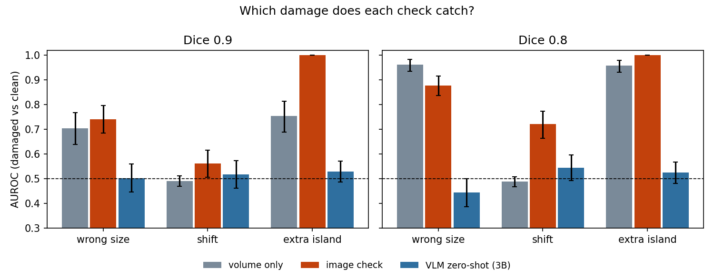

# Which segmentation-mask errors does a simple check catch, and which does it miss?

A small audit loop: take MRI segmentation masks that are assumed correct, damage them in three known ways at two known sizes, run automatic checks, and report how well each separates damaged from undamaged masks. The point is the list of blind spots.
Design, written before the runs (including numeric predictions and a decision rule): [DESIGN.md](DESIGN.md).

**Data.** Medical Segmentation Decathlon, Task04 Hippocampus (CC-BY-SA 4.0), 260 cases, anterior + posterior labels merged into one binary mask. Public data; method demo only, no clinical claim.

## What was done
- **Damage, size set by overlap (Dice) with the clean mask, 0.9 and 0.8.** Each case gets its own parameter by bisection; the target was hit within 0.01 for 100% of 60 pilot cases (`pilot_damage.py`).
  - *wrong size*: smoothed mask thresholded up (too small) or down (too big); volume -18% / -33% or +22% / +50% at Dice 0.9 / 0.8
  - *shift*: mask moved in a random direction (volume about -3%)
  - *extra island*: a separate ball away from the structure; volume +22% / +50% (the 0.8 island is half the structure, which is extreme)
- **Three checks**
  - *volume only* (never sees the image): distance of the mask volume from normal; the population volume spread is 13%
  - *image check*: larger of (a) how abnormal the image edge strength along the mask boundary is (two-sided) and (b) 3 x (connected pieces - 1). Calibrated on clean masks of cases 0-99; no labels learned
  - *VLM, zero-shot*: local Qwen2.5-VL-3B-Instruct, no training, no examples. It sees three MRI slices with the red outline plus the mask alone projected along one axis, and is asked YES/NO whether the outline is correct. Score = log P(NO) - log P(YES) at the first answer token (no text parsing)
- **Test:** cases 100-259 (160), each gives one clean and one damaged version per (error, size). AUROC with a 95% CI from resampling cases (2000 resamples).

## Result (AUROC, damaged vs clean; 0.5 = chance)


| error | Dice | volume only | image check | VLM zero-shot |
|---|---|---|---|---|
| wrong size | 0.9 | 0.70 (0.64-0.77) | 0.74 (0.69-0.80) | 0.50 (0.45-0.56) |
| wrong size | 0.8 | 0.96 (0.94-0.98) | 0.88 (0.84-0.91) | 0.44 (0.39-0.50) |
| shift | 0.9 | 0.49 (0.47-0.51) | 0.56 (0.51-0.62) | 0.52 (0.46-0.57) |
| shift | 0.8 | 0.49 (0.47-0.51) | 0.72 (0.66-0.77) | 0.54 (0.49-0.60) |
| extra island | 0.9 | 0.75 (0.69-0.81) | 1.00 (1.00-1.00) | 0.53 (0.49-0.57) |
| extra island | 0.8 | 0.96 (0.93-0.98) | 1.00 (1.00-1.00) | 0.53 (0.48-0.57) |

Numbers: `results/main_auroc.csv` (all checks and parts), `results/vlm2_auroc.csv`, `results/main_plus_vlm_auroc.csv`.

## What it means
1. **A volume check is blind to a shifted mask** (0.49 at both sizes): shifting does not change the volume. It finds anything that does change the volume enough.
2. **A shift of Dice 0.9 is caught by nothing here**: the best check reaches 0.56 (CI 0.51-0.62), and the first-round one-sided edge check 0.64.
3. **The image check's connected-pieces part finds the island perfectly, but this is nearly by construction**: the island is placed away from the structure, so it is always a separate piece. An extra region that touches the structure was not tested and would not be found this way.
4. **The edge signal's useful direction depends on the error.** One-sided (weak edge = suspicious) is better on shift (0.64 / 0.77) and island, two-sided is better on wrong size (0.74 / 0.88 against 0.55 / 0.64). No single edge rule covers all errors.
5. **The zero-shot 3B VLM is not usable here.** It is at chance on all six settings (0.44-0.54; no confidence interval has its lower bound above 0.5), including the island at Dice 0.8, which is half the structure and visible in the projection panel. It answered NO on 1120 of 1120 images, so it behaves like a constant "no" with small image-dependent wiggles (mean score 0.475 on clean vs 0.456-0.483 on every damaged group). The answer format itself was fine (98.8% of probability on YES/NO). Why it ignores the outline was not investigated.

## Predictions fixed before the runs (DESIGN.md)
- Two-check predictions A1-A6: all confirmed (`results/main_predictions.csv`). They were fairly safe; A5 (image check below volume on wrong size at Dice 0.8) is 0.88 against 0.96.
- VLM predictions: **V1** (below 0.7 everywhere) confirmed, **V4** (never beats the best simple check) confirmed, **V2** (best at island Dice 0.8) **refuted** (the highest point estimate is shift at Dice 0.8, 0.54, but all six are within noise of each other), **V3** (prompt agreement Spearman < 0.6) **refuted**: 0.65 between two wordings on 280 items.
- Decision rule from the design: no setting reaches 0.8 and none has a CI lower bound above 0.5, so the result is "not usable zero-shot at 3B" and **no larger model was tried**.
- Exploratory, not planned: the 0.65 agreement is mostly between-case differences; on the change that damage causes (damaged minus the same case's clean score) it is 0.46, and the second wording's AUROC (40 cases, noisy) is 0.43-0.58. So the VLM's score does move with the picture, but not in a direction that separates damaged from clean.

## Limits
- One small dataset (crops about 35 x 50 x 35 voxels, 1 mm); damage is synthetic and its size (Dice) is not matched to real annotator disagreement, which was not measured.
- All 260 cases were used in a first round, where the edge check was changed to two-sided after looking at results. No other labelled data exist, so the test is not fully clean; check definitions, damage method, prompts and seeds were fixed before the runs, and nothing was tuned on cases 100-259.
- The VLM test is zero-shot with one 3B model and one main prompt. It does **not** show that VLMs cannot do this: a larger model, a few worked examples, or reading the model's internal representation with a trained probe were not tried. The image is also far from what such models are trained on (tiny low-resolution MRI crops).
- Only simple checks; no learned model finished (an unfinished CNN attempt is in `archive/unfinished_cnn/`, nothing from it is used).

## Files
- `audit/damage.py` damage at a target Dice; `audit/detectors.py` the simple checks; `audit/vlm.py` + `audit/overlay.py` (`render_v2`) the VLM check; `audit/load_msd.py`
- `pilot_damage.py` (damage pilot), `run_main.py` (two simple checks), `run_vlm_main.py` (VLM; `--pilot` first), `make_figure_with_vlm.py`
- First round, kept for the record: `run_synthetic.py`, `run_msd.py`, `run_vlm.py`, `run_prompt_sens.py`, `audit/corrupt.py`, `audit/evaluate.py`, `audit/synth.py`. In that round the damage sizes were set in voxels (very uneven difficulty) and the slices could not show a distant island; its VLM result (AUROC 0.27-0.50, answered NO on 700/700 images) is superseded by the test above
- `archive/` shelved design and the unfinished CNN

## Reproduce
```
# data: Task04_Hippocampus.tar (MSD) extracted into data_raw/msd_hippocampus/
python3 pilot_damage.py        # does the damage hit the Dice targets? (cases 0-59)
python3 run_main.py            # volume + image check, about 50 s
python3 run_vlm_main.py --pilot   # VLM format and speed (cases 0-59), about 6 min
python3 run_vlm_main.py        # VLM on the test cases, about 1 h on an Apple M4 (resumable)
python3 make_figure_with_vlm.py
```
Requires numpy, scipy, pandas, scikit-learn, matplotlib, nibabel, Pillow. The VLM scripts also need torch, transformers and torchvision, plus the model (about 7.5 GB; delete `~/.cache/huggingface/hub/models--Qwen--Qwen2.5-VL-3B-Instruct` when no longer needed).
